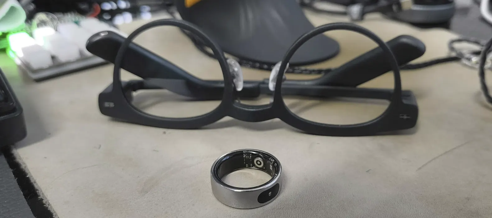
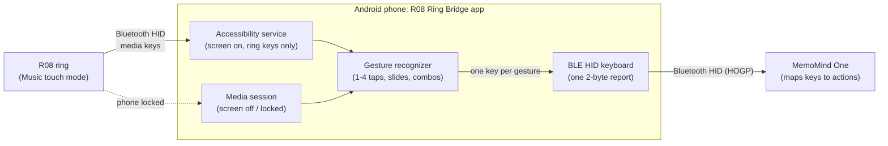

# R08 Ring Bridge (Android)

Smartglasses without an additional interface aren't smart. A cheap wearable ring can fix this.

This project tries to reduce the friction of these new wearable face screens and user interaction. The ring captures touch inputs and mimics the glasses' button commands.

Hardware required:
- YaWell/Colmi **R08** Smart Ring
- **MemoMind One** Smart Glasses

The smart ring acts as a controller for glasses, with multi-tap gestures (double, triple, quadruple tap) and scroll. At the date of writing this document KiwiWear is the only smart ring ready product for the MemoMind ecosystem. That device costs around $300, whereas this Colmi ring implementation delivers part of the same functionality for a tenth of the price at just $30.
The caveat is that the ring can't connect directly to the glasses without custom firmware, so we use a phone as a Bluetooth bridge between devices.

Project Diagram:


## How it fits together

There are two layers:

1. **R08 Ring Bridge app (phone): ring gesture → keyboard key**
2. **MemoMind app: keyboard key → glasses action.** You set this up by recording, using the ring.

### What each ring gesture sends (bridge defaults)

| Ring gesture | Key the bridge sends | Glasses without any mapping |
|---|---|---|
| Slide up / down | Up / Down arrow | Up / Down |
| 1 tap | (nothing) | - |
| 2 taps | Enter | Single click |
| 3 taps | Escape | Back |
| 4 taps | Pause/Resume (media key) | nothing (see "Keys the bridge can send") |
| Tap, then slide up / down | Left / Right arrow | Left / Right |
| Slide up, then tap | Next track (media key) | nothing (see "Keys the bridge can send") |
| Slide down, then tap | Previous track (media key) | nothing (see "Keys the bridge can send") |

Timing defaults: tap window **350 ms**, combo buffer **500 ms**. Because "slide, then tap" gestures are
assigned, a plain slide waits up to the combo buffer (500 ms) for a possible tap before it fires.

Every gesture can be reassigned in the bridge app (Gesture → glasses action). Gestures you leave
unassigned add no delay to the others.

### Keys the bridge can send (HID reference)

Each action is one **press** (the report bytes below) followed about 90 ms later by a **release**
(`00 00`). The glasses receive the 2-byte input report (Report ID 1) as a notification on the
Report characteristic `0x2A4D`. Byte 0 holds keyboard keys, byte 1 holds media keys.

| Bridge action | Report bytes (press) | HID page / usage (hex) | Input-map JSON (decimal) | Glasses by default | Recordable in MemoMind |
|---|---|---|---|---|---|
| Up | `01 00` | 0x07 / 0x52 Up Arrow | `"page":7,"usage":82` | UP | yes |
| Down | `02 00` | 0x07 / 0x51 Down Arrow | `"page":7,"usage":81` | DOWN | yes |
| Left | `04 00` | 0x07 / 0x50 Left Arrow | `"page":7,"usage":80` | LEFT | yes |
| Right | `08 00` | 0x07 / 0x4F Right Arrow | `"page":7,"usage":79` | RIGHT | yes |
| Single press (Enter) | `10 00` | 0x07 / 0x28 Enter | `"page":7,"usage":40` | single press | yes |
| Back (Escape) | `20 00` | 0x07 / 0x29 Escape | `"page":7,"usage":41` | BACK | yes |
| Next track | `00 01` | 0x0C / 0xB5 Scan Next | `"page":12,"usage":181` | nothing | no |
| Previous track | `00 02` | 0x0C / 0xB6 Scan Previous | `"page":12,"usage":182` | nothing | no |
| Pause/Resume | `00 04` | 0x0C / 0xCD Play/Pause | `"page":12,"usage":205` | nothing | no |
| Mute | `00 08` | 0x0C / 0xE2 Mute | `"page":12,"usage":226` | nothing | no |
| Volume up | `00 10` | 0x0C / 0xE9 Volume Increment | `"page":12,"usage":233` | nothing | no |
| Volume down | `00 20` | 0x0C / 0xEA Volume Decrement | `"page":12,"usage":234` | nothing | no |
| *(release, after every press)* | `00 00` | | | | |

Two more keys exist in the layout but have no action in the app:

| Key | Report bytes | HID page / usage | Glasses by default |
|---|---|---|---|
| Keypad Enter | `40 00` | 0x07 / 0x58 (decimal 88) | single press |
| Space | `80 00` | 0x07 / 0x2C (decimal 44) | nothing |

What this means:

- The **first six** are the only keys the glasses understand on their own, so they're the only ones
  the MemoMind app can record and give an "AI glasses action" (Single/Double click, Back, Open AI chat,
  Open quick menu, Turn off screen, ...).
- The **media keys** reach the glasses but do nothing by default: inside the bridge's keyboard report
  the firmware doesn't recognize them. An **input map sent from the PC** (see "Advanced") can still
  target them by page/usage, e.g. `{"type":"usage_key","page":12,"usage":205,"key":59}` turns
  Pause/Resume into the glasses' long press (`KEY_LONG`, 59 = 0x3B). Whether the glasses expose them
  for mapping is still to be confirmed with `mm_hogp.py … listen` (expect `"page":12,"usage":205`
  when pressing the Play test button).
- Everything stays in **one** HID report. A second HID report broke the connection with the glasses
  in earlier versions, so don't add one.

### Example mapping (the setup this project was built with)

| Ring | Mapped in the MemoMind app to | Result on the glasses |
|---|---|---|
| Slide up / down | (built-in, no mapping needed) | Move up / down |
| **Double tap** (bridge: Enter) | Double click | Enter / open menu |
| **Triple tap** (bridge: Escape) | Back | Back / exit |

## Setup

### 1. Install the app

Download the APK from this repository's **Actions** tab (latest successful run →
artifact `R08-Ring-Bridge-debug-APK` → `app-debug.apk`), copy it to the phone and install it
(allow "Install unknown apps"). Android 12 or newer.

**Updating:** builds are signed with the fixed key in `app/ringbridge-debug.keystore`, so a new
APK installs over the old one as an update and keeps your settings. (Builds from before this key
was added were signed with a random key: uninstall those once.)

### 2. Connect the ring to the phone

1. Put the ring in **Music** touch mode (QRing → Touch control → Music).
2. **Force-stop QRing** afterwards (or unbind the ring in QRing). Otherwise QRing reconnects to the
   ring and can change its mode. Turn off Bluetooth on other devices that use the ring (e.g. an
   e-reader).
3. Android **Settings → Bluetooth → Pair new device → `R08_xxxx`**.

### 3. Set up the bridge app

1. Open **R08 Ring Bridge** → **Grant Bluetooth permissions**.
2. **Enable the ring service:** Settings → Accessibility → R08 Ring Bridge → On.
   If Android says **"Restricted setting"**: Settings → Apps → R08 Ring Bridge → ⋮ (top right) →
   **Allow restricted settings**, then enable it again.
3. **Start / restart the bridge.** This starts the HID advertising and a background service with a
   small permanent notification ("Ring → glasses bridge running"), which keeps the bridge alive
   while the phone is locked. Allow notifications when asked.
4. Check the status at the top: slide the ring and **Last ring key** should show something like
   `KEYCODE_MEDIA_NEXT from R08_xxxx (screen on)`. If it stays `-`, set **Ring device name contains**
   to part of the name the ring has in Android's Bluetooth settings.
5. **Battery:** tap "Battery: set R08 Ring Bridge to Unrestricted" and set the app to
   *Unrestricted* / *Don't optimize*, so the phone does not pause it while locked.

### 4. Connect the phone to the glasses

1. If the ring was previously connected directly to the glasses, remove it first: the glasses keep
   only one third-party device.
2. **MemoMind app → Memo Lab → Third-party devices → Scan** → select **your phone's name**.
3. Accept the Bluetooth pairing prompt on the phone. The bridge app shows
   `READY: glasses subscribed`.
4. Choose a device type, then **Confirm and Continue**.

### 5. Map the actions you want, using the ring

In the MemoMind app's mapping screen, for each glasses action you want:

1. Start recording for that action.
2. Do the ring gesture you want for it (for example a **double tap** for double press, a
   **triple tap** for long press).
3. Save.

Slides already move up and down through the glasses' built-in keyboard support. They only need
mapping if you want them to do something else.

The bridge app's **Up / Down / Double / Long** test buttons send the same keys as the ring
gestures, which is handy for testing without the ring.

## Switching the ring back to Music mode

The bridge needs the ring in **Music** touch mode. If you use the ring in another mode elsewhere (for
example E-book on an e-reader), you don't need QRing to switch back:

1. Turn off the e-reader's Bluetooth (the ring talks to one device at a time).
2. In the bridge app, tap **Ring → Music mode**.

The app sends the same commands QRing uses (`3B 02 00 01 05`, `3B 02 01 00 00`, `3B 02 02 01 01`)
over the ring's command channel. The ring restarts its Bluetooth link to apply a new mode, so
the app reconnects, finishes, and then **reads the mode back** (`3B 01 00`). The status line
"Ring touch mode" shows the result, and the event log shows each step (`ring: …`).
**Read ring mode** only reads the current mode.

## Using it with the phone locked

With the screen off, Android sends media keys to the "media button" app (the app that most
recently started audio, e.g. your music player) instead of the Accessibility service. With the
**"Work while the phone is locked"** switch on (default), **the ring always controls the glasses**:

- **Screen off:** the bridge takes the media buttons (it plays a quarter second of silence, which
  makes it the most recent audio app) and **takes them again every time another app starts audio**,
  such as when the next song starts. Ring keys become glasses actions. Every other media key,
  including the glasses' own music controls (next, pause) and headphone buttons, is **ignored**
  while the phone is locked (logged as `ignored … (not from the ring; phone locked)`).
- **Screen on:** the bridge releases the media buttons. Accessibility handles the ring as usual and
  the glasses' music controls work normally.

A foreground service (notification "Ring → glasses bridge running") keeps this running.

**Checking it:** lock the phone, use the ring, unlock and open the app. The **Event log** shows,
in order: `screen off`, `claimed media buttons`, then for each ring event `key ...`,
`gesture ... -> ...` and `sent key to glasses`. Where the chain stops tells you what failed:

| Last entry you see | Meaning |
|---|---|
| `screen off` but no `key ...` | The ring's keys did not reach the app while locked (another app took the media buttons, or the system dropped them) |
| `key ...` but no `gesture ...` | Only possible with combos assigned: the gesture is still waiting for the buffer |
| `NOT sent: glasses not subscribed` | The glasses' link to the phone dropped |
| `sent key to glasses` but nothing happens | The glasses received it; check the MemoMind mapping |

Side effect: while the screen is off, your headphones' play/pause/next buttons also go to the
bridge, which ignores them. If you start music in another app after the screen is already off,
that app takes the media buttons back until the screen turns off again. Turn the switch off if
you prefer the old behavior (ring works only with the screen on).

## Settings in the bridge app

| Setting | Default | What it does |
|---|---|---|
| Tap window | 350 ms | Maximum gap between taps of one multi-tap |
| Combo buffer | 500 ms | How long a tap waits for a slide ("tap, then slide") and a slide for a tap ("slide, then tap"). Only used when such a combo is assigned |
| Long-press hold | 2100 ms | How long held actions keep the key down |
| Ring device name contains | `R08` | Only input devices with this in their name are captured; everything else passes through |
| Work while the phone is locked | on | Takes media buttons while the screen is off (see above) |

## Troubleshooting

- **Taps or slides also control the phone's music:** the Accessibility service is off, or the ring's
  name does not match the filter.
- **Ring does nothing while the phone is locked:** check that the notification "Ring → glasses
  bridge running" is there, the "Work while the phone is locked" switch is on and the app's
  battery setting is *Unrestricted*. Then read the event log (see "Using it with the phone
  locked").
- **Ring stops responding after a while:** QRing (or another device) took over the ring. Force-stop
  QRing and reconnect the ring in Android's Bluetooth settings.
- **Glasses don't see the phone when scanning:** press "Start / restart HID advertising". If the
  status says advertising failed with error 1, shorten the phone's Bluetooth name.
- **A multi-tap comes out as separate taps:** tap faster, or raise the tap window.
- **"Tap, then slide" comes out as a tap and a separate slide:** the ring only reports a slide
  after it has recognized the swipe, so the slide arrives well after the tap. The status line
  **Last gap tap->slide** shows the measured gap: set the **Combo buffer** above your typical gap
  (e.g. gap 700 ms → buffer 900-1000 ms). Note that while a tap-then-slide combo is assigned,
  a single tap waits for the buffer before it fires.
- **Glasses find the phone but don't connect** (often after reinstalling or after an update that
  changed the bridge's keys): leftover pairing keys. In nRF Connect → BONDED, delete the bond of the glasses' BLE
  entry (the MemoMind One entry that is *not* the glasses' main address), remove the phone in
  MemoMind's third-party devices, then pair again with the bridge app open. The event log shows
  `link UP/DOWN (status ...)` and `bond ...: PAIRED / PAIRING FAILED` lines for each attempt.

## Advanced: input map without the MemoMind app

The glasses' input map can map **any** key by HID page/usage, including the media keys the MemoMind
app can't record. It's sent from a PC with the GM/SPP tool from this project, with the MemoMind app
force-stopped and the phone's Bluetooth on:

```
py -u mm_hogp.py <GLASSES_MAC> --channel 1 map my_map.json listen
```

Example: 2 taps (Enter) → double click, 4 taps (Pause/Resume, `00 04`) → long press:

```json
{"version":1,"rules":[
  {"type":"usage_key","page":7,"usage":40,"key":58},
  {"type":"usage_key","page":12,"usage":205,"key":59}
]}
```

- A map **replaces the whole table**, including what you recorded in the MemoMind app, so include
  those mappings in it.
- Useful glasses keys: 4 SELECT (short = single, held = long), 5 BACK, 7 MENU, 58 DOUBLE,
  59 LONG, 60 AI_TRIGGER. The full list is in the replication guide.
- The MemoMind app may replace the map when it reconnects or when you edit mappings there.
  Recording in the MemoMind app (step 5) remains the main way.

## Build from source

- **GitHub:** pushing to `main` runs `.github/workflows/build-apk.yml` and uploads the APK as an
  artifact.
- **Android Studio:** open the folder and Run. No external libraries.
